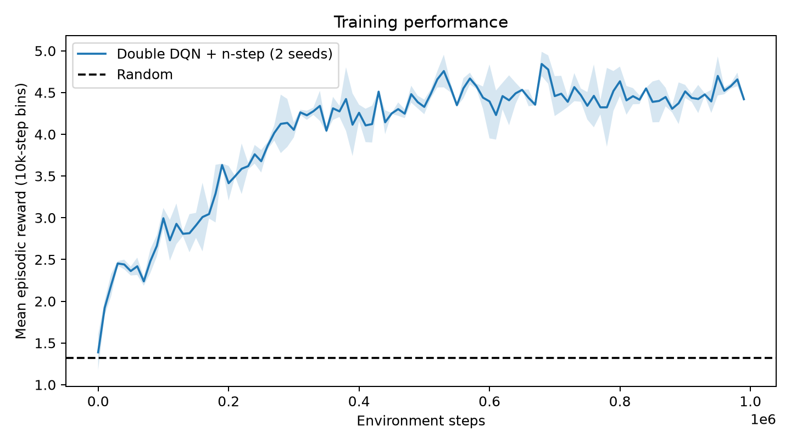
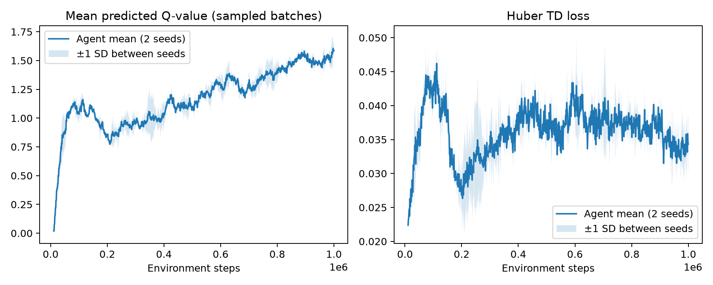
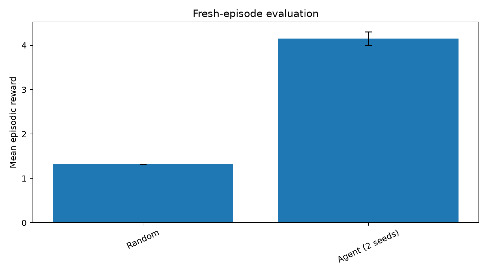
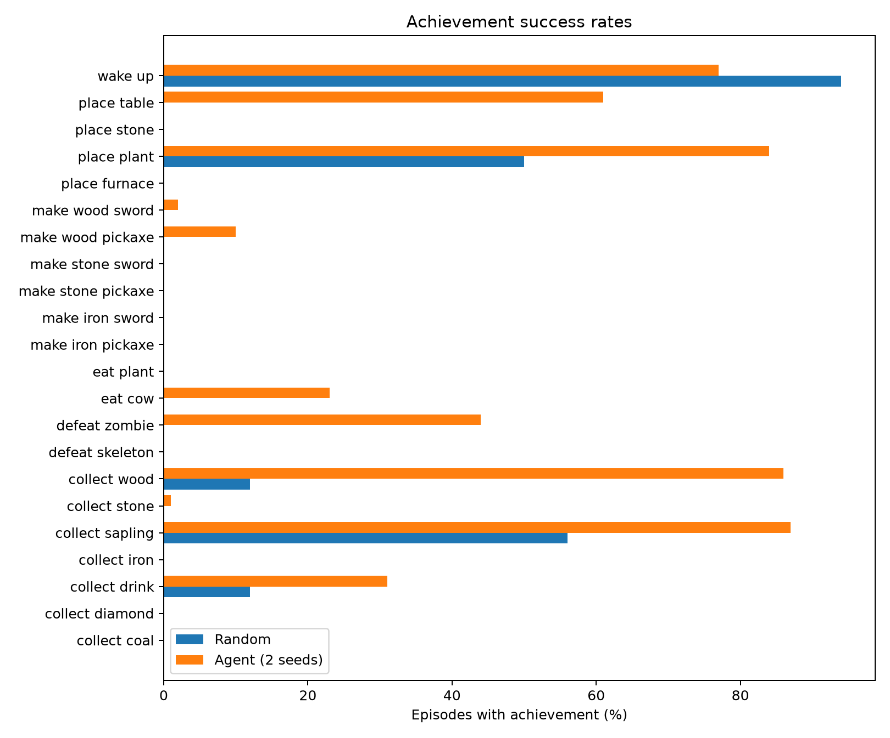

# Crafter RL — Double DQN à retours n-step (Projet AAIT)

**Binôme :** Kilian Calmets & Mathis Pezet  
**Environnement :** [Crafter](https://github.com/danijar/crafter) (`64 × 64` RGB, 17 actions discrètes, 22 achievements)  
**Algorithme :** Double DQN + retours 3-step, implémenté en PyTorch (`agent/`, `train.py`)

> **Calendrier officiel :**
> - **Dépôt Moodle (hard cut-off) :** dimanche **15 novembre 2026 à 23h59** (`Rendu_final_Calmets_Pezet/`)
> - **Soutenances orales :** mardi **24 novembre 2026** et mardi **8 décembre 2026**

---

## Navigation rapide

| Espace | Dossier / Fichier | Ce qu'on y trouve |
|---|---|---|
| **1. Rendus officiels Moodle** | [`Rendu_final_Calmets_Pezet/`](Rendu_final_Calmets_Pezet/README.md) | Les 2 fichiers exacts à déposer sur Moodle : [`Calmets_Kilian.pdf`](Rendu_final_Calmets_Pezet/Calmets_Kilian.pdf) (**11 slides**) et [`Calmets_Kilian.zip`](Rendu_final_Calmets_Pezet/Calmets_Kilian.zip) |
| **2. Préparation de l'oral** | [`docs/00_GUIDE_COMPLET_ORAL.md`](docs/00_GUIDE_COMPLET_ORAL.md) | **Guide tout-en-un** : script des 11 slides, timing, repères exacts dans le code, chiffres clés et 10 questions pièges + réponses |
| **3. Notes détaillées (`docs/`)** | [`docs/00_accueil.md`](docs/00_accueil.md) | Parcours thématique en 6 fiches (`01_methode.md` à `05_recherche_baseline.md`) |
| **4. Code source** | [`train.py`](train.py) · [`agent/`](agent/) | Architecture CNN, replay buffer `uint8`, retours *n*-step, évaluation, métriques, figures et dashboard Streamlit |
| **5. Résultats & graphiques** | [`runs/`](runs/) · [`figures/`](figures/) | Courbes scalaires (`scalars.csv`), validations 300k/500k/1M, évaluation finale (50 ép.), trace comportementale et graphiques PNG |

---

## Préparation de l'oral (`docs/`)

Tout ce qu'il faut maîtriser pour la soutenance est regroupé dans [`docs/`](docs/) :

| Fichier | Rôle |
|---|---|
| [`00_GUIDE_COMPLET_ORAL.md`](docs/00_GUIDE_COMPLET_ORAL.md) | **Fiche maître de révision** : pitch 45 s, déroulé slide par slide (1 à 11), répartition binôme, repères lignes de code et Q&A |
| [`00_accueil.md`](docs/00_accueil.md) | Vue d'ensemble et parcours de lecture |
| [`01_methode.md`](docs/01_methode.md) | Équations mathématiques (DQN, Double DQN, retour *n*-step avec horizon réel, Huber) et correspondance code |
| [`02_protocole_et_resultats.md`](docs/02_protocole_et_resultats.md) | Protocole complet, tableaux de résultats, validation, comportements tracés et limites honnêtes |
| [`03_rendu_et_slides.md`](docs/03_rendu_et_slides.md) | Plan détaillé des 11 slides en anglais + notes orales (*Say:*) |
| [`04_oral_questions.md`](docs/04_oral_questions.md) | Banque complète de questions probables du jury et formulations précises |
| [`05_recherche_baseline.md`](docs/05_recherche_baseline.md) | Vérification documentaire sur l'absence de score publié pour la baseline « coding agent » |

---

## Résultats mesurés (1M de pas, évaluation finale gloutonne ε = 0)

Deux entraînements indépendants (**seed 1** et **seed 2**, `1 000 000` pas chacun) ont été sélectionnés à `1M` sur 30 épisodes de validation (`3001–3030`) avant d'être évalués sur **50 nouveaux épisodes chacun** (`7001–7050`) en politique gloutonne (ε = 0), face à l'agent aléatoire sur les **mêmes 50 seeds**.

| Agent | Reward épisodique | Score Crafter | Longueur moyenne (pas) | Source |
|---|---:|---:|---:|---|
| Aléatoire (50 ép.) | 1,32 | 1,23 % | 170,2 | [`runs/random_seed7001/summary.json`](runs/random_seed7001/summary.json) |
| Double DQN + 3-step · Seed 1 (50 ép.) | 4,04 | 3,72 % | 190,16 | [`runs/final_1m_g4_seed1/summary.json`](runs/final_1m_g4_seed1/summary.json) |
| Double DQN + 3-step · Seed 2 (50 ép.) | 4,26 | 4,56 % | 191,84 | [`runs/final_1m_g4_seed2/summary.json`](runs/final_1m_g4_seed2/summary.json) |
| **Moyenne Agent (2 seeds)** | **4,15 ± 0,16** | **4,14 ± 0,60 %** | **191,0 ± 1,2** | [`runs/final_report.json`](runs/final_report.json) |
| **Gain vs aléatoire apparié** | **+2,83** | **+2,91 pts** | **+20,8 pas** | — |

> *Les ± indiquent l'écart-type entre les deux moyennes par seed d'entraînement (N = 2), pas un intervalle de confiance.*

- **Validation des checkpoints (`3001–3030`, 30 ép.) :** `300k` = `3,62 %` (R `4,28`) → `500k` = `3,81 %` (R `4,53`) → **`1M` = `4,08 %` (R `4,48`)**
- **Diagnostics (`scalars.csv`) :** la Q-value moyenne passe de `0,02` (fenêtre `11k`) à `1,57` (moyenne des `10k` derniers pas ; `1,59` sur la toute dernière fenêtre `1M`) sans divergence, et la perte Huber TD reste stable autour de `0,034`.
- **Limites clés :** aucune ablation séparée DQN vs Double DQN vs *n*-step à budget égal ; observation unique `64 × 64` sans mémoire temporelle ; `collect_stone` atteint dans `1 %` des épisodes finaux (`0 %` pour `make_stone_pickaxe`) ; aucun score/protocole communiqué pour la baseline « coding agent » ([`docs/05_recherche_baseline.md`](docs/05_recherche_baseline.md)).

### Aperçu des graphiques

| Entraînement (`training_reward.png`) | Diagnostics Q & loss (`training_diagnostics.png`) |
|---|---|
|  |  |

| Évaluation finale (`evaluation_reward.png`) | Compétences débloquées (`achievements.png`) |
|---|---|
|  |  |

---

## Arborescence du dépôt et rôle des fichiers

```text
AAIT/
├── Rendu_final_Calmets_Pezet/     # Livrables officiels prêts pour Moodle
│   ├── Calmets_Kilian.pdf         # Diaporama final (11 slides, 16:9, anglais)
│   ├── Calmets_Kilian.zip         # Archive source propre (28 fichiers, sans .pt)
│   └── README.md
├── docs/                          # Documentation complète & préparation de l'oral
│   ├── 00_GUIDE_COMPLET_ORAL.md   # Guide complet de soutenance (slides, code, Q&A)
│   ├── 00_accueil.md ... 05_recherche_baseline.md
├── agent/
│   ├── __init__.py
│   ├── network.py                 # CNN (32->64->64 + FC 512 -> 17 Q-values)
│   └── replay.py                  # ReplayBuffer uint8 + NStepAccumulator (horizon réel)
├── figures/                       # Figures PNG prêtes pour les slides
├── runs/                          # Logs d'entraînement, validations 300k/500k/1M, test final et trace
├── train.py                       # Boucle Double DQN + 3-step (config retenue par défaut)
├── evaluate.py                    # Évaluation gloutonne (ε = 0) ou aléatoire + trace JSONL
├── metrics.py                     # Reward moyen, longueur, taux de succès et score Crafter
├── report.py                      # Agrégation multi-seeds (moyenne & écart-type entre seeds)
├── figures.py                     # Génération des figures matplotlib (slides + diagnostics)
├── dashboard.py                   # Tableau de bord interactif Streamlit
├── make_submission.ps1            # Générateur de l'archive Moodle Calmets_Kilian.zip
├── ouvrir_interface.cmd / .ps1    # Lanceur Windows du dashboard Streamlit (port 8517)
├── fermer_interface.cmd / .ps1    # Arrêt propre du dashboard Streamlit
├── requirements.txt
└── .gitignore                     # Exclut .venv/, caches et poids *.pt
```

> **Note sur les fichiers ignorés par Git (`.gitignore`) :** les poids PyTorch (`*.pt`), l'environnement virtuel (`.venv/`), les caches Python et les évaluations temporaires du dashboard ne sont pas versionnés sur GitHub pour garder un dépôt léger. Par conséquent, le volet latéral **« Tester un agent »** de `dashboard.py` reste vide tant que des checkpoints `checkpoint_*.pt` n'ont pas été réentraînés ou copiés localement dans `runs/`.

---

## Démarrage rapide (FR)

### 1. Installer les dépendances (Python 3.11–3.13)

Sous Windows (forcer UTF-8 si la compilation d'une dépendance Crafter échoue) :

```powershell
$env:PYTHONUTF8 = '1'
python -m venv .venv
.\.venv\Scripts\python.exe -m pip install -r requirements.txt
```

Sous Linux / macOS / Colab :

```bash
pip install -r requirements.txt
```

### 2. Ouvrir le tableau de bord local

- Sous Windows (avec `.venv` prêt) : double-cliquer sur `ouvrir_interface.cmd` (ou `.\ouvrir_interface.ps1`), puis ouvrir `http://127.0.0.1:8517`. Pour arrêter : `fermer_interface.cmd`.
- Directement en CLI :

```bash
streamlit run dashboard.py
```

### 3. Reproduire l'entraînement, l'évaluation et les figures

`python train.py` sans argument exécute directement la **configuration retenue** (`steps=1_000_000`, `algorithm="double"`, `n_step=3`, `gamma=0.99`, `buffer_size=50_000`, `batch_size=32`, `learning_rate=1e-4`, `epsilon` de `1.0` à `0.05` sur `150_000` pas).

```bash
# Entraîner les 2 seeds (sans écraser runs/ existants grâce à --out)
python train.py --seed 1 --out runs/repro_seed1
python train.py --seed 2 --out runs/repro_seed2

# Évaluer les checkpoints finaux (ε = 0) et l'agent aléatoire sur les mêmes 50 épisodes
python evaluate.py --checkpoint runs/repro_seed1/checkpoint_1000000.pt --episodes 50 --seed 7001 --out runs/eval_seed1
python evaluate.py --checkpoint runs/repro_seed2/checkpoint_1000000.pt --episodes 50 --seed 7001 --out runs/eval_seed2
python evaluate.py --episodes 50 --seed 7001 --out runs/eval_random

# Agréger les deux seeds d'évaluation
python report.py runs/eval_seed1 runs/eval_seed2 --out runs/report_repro.json
```

Pour régénérer les figures à partir des données présentes dans `runs/` :

```bash
python figures.py ^
  --train runs/double_nstep_1m_g4_seed1 runs/double_nstep_1m_g4_seed2 ^
  --eval runs/final_1m_g4_seed1 runs/final_1m_g4_seed2 ^
  --eval-curve runs/val_300k_g4_seed1 runs/val_300k_g4_seed2 runs/val_500k_g4_seed1 runs/val_500k_g4_seed2 runs/val_1m_g4_seed1 runs/val_1m_g4_seed2 ^
  --scalars runs/double_nstep_1m_g4_seed1 runs/double_nstep_1m_g4_seed2 ^
  --random runs/random_seed7001 ^
  --out figures
```

---

## Quick Start (English)

Hand-written Double DQN with 3-step returns for Crafter by **Kilian Calmets** and **Mathis Pezet**. Final greedy (ε = 0) evaluation across 2 training seeds (50 fresh episodes each, seeds `7001–7050`) reaches **4.15 ± 0.16** episodic reward and **4.14 ± 0.60 %** Crafter score vs **1.32** and **1.23 %** for random play on the same episodes (`runs/final_report.json`).

```bash
pip install -r requirements.txt
python train.py --seed 1 --out runs/repro_seed1
python train.py --seed 2 --out runs/repro_seed2
python evaluate.py --checkpoint runs/repro_seed1/checkpoint_1000000.pt --episodes 50 --seed 7001 --out runs/eval_seed1
python evaluate.py --checkpoint runs/repro_seed2/checkpoint_1000000.pt --episodes 50 --seed 7001 --out runs/eval_seed2
python evaluate.py --episodes 50 --seed 7001 --out runs/eval_random
python report.py runs/eval_seed1 runs/eval_seed2 --out runs/report_repro.json
```

See [`Rendu_final_Calmets_Pezet/`](Rendu_final_Calmets_Pezet/README.md) for the Moodle deliverables and [`docs/03_rendu_et_slides.md`](docs/03_rendu_et_slides.md) / [`docs/00_GUIDE_COMPLET_ORAL.md`](docs/00_GUIDE_COMPLET_ORAL.md) for the English slide deck outline and oral notes.
